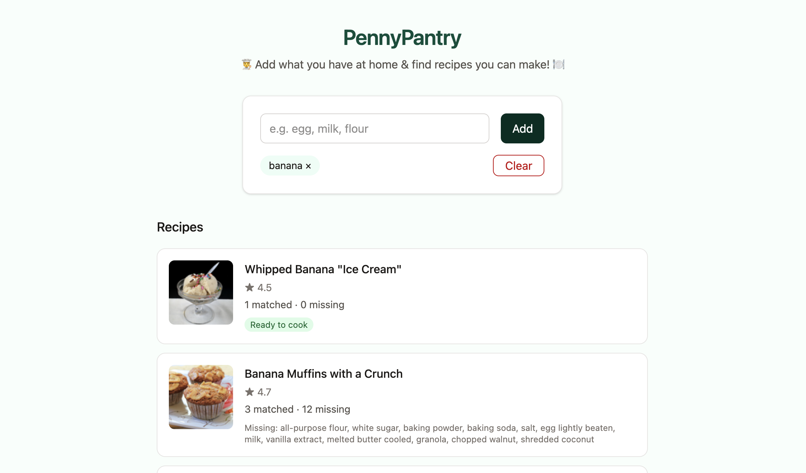
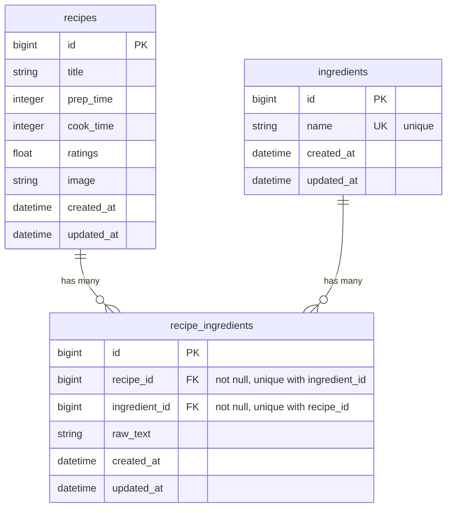

# PennyPantry

A full-stack application that helps users find the most relevant recipes that they can prepare with the ingredients that they have at home. 

[Check out the live demo here](https://pennypantry.vercel.app/)!

> [!NOTE]
> Due to Render's free tier limits, the live database will go offline after October 25, 2026. Please run the app locally to test it out.



**Table of contents**
1. [User stories](#1-user-stories)
2. [How it works](#2-how-it-works)
3. [Decisions & tradeoffs](#3-decisions--tradeoffs)
4. [Database schema](#4-database-schema)
5. [Stack & setup](#5-stack--setup)
6. [Tests](#6-tests)
7. [What I'd do with more time](#7-what-id-do-with-more-time)
8. [What I'd change for production](#8-what-id-change-for-production)
9. [Appendix](#appendix) (Original problem statement)

## 1. User stories
1. Search recipes by a user's pantry ingredients
2. See ranked recipes that match a user's search input
3. Know which recipes are ready to cook, and which ingredients a user is missing

## 2. How it works

Add ingredients a user has at home. PennyPantry returns a ranked list of recipes: fully doable ones first (marked **Ready to cook**), then the closest pantry overlaps, each showing how many ingredients match and which are still missing. Open a recipe to see the full list, with missing items greyed out.

- **Matching**: pantry and recipe lines are normalized, then compared with a whole-word match so `egg` hits `eggs` but not `eggplant`. Normalization strips a leading quantity, then one leading unit from a fixed list (`cup`, `bunch`, `clove`, and so on), drops punctuation and consecutive duplicate words, and singularizes each word. A later unit, or one not in that list, stays. Adjectives like "medium" or "sliced" stay too.
- **Ranking**: doable recipes first, then most matches, then fewest missing, then higher rating. A recipe you can cook with 2 pantry items ranks above one you can cook with 1. With the same number of matches, 5 missing ranks above 6 missing. Rating only breaks a remaining tie.

Until you add an ingredient, the page shows a random sample of recipes so it isn’t blank. Search and ranking only start once the pantry has something in it.

## 3. Decisions & tradeoffs

| Area | Chose | Over | Why (prototype) |
|---|---|---|---|
| Architecture | React + Rails API, monorepo | Rails views | I already know React, so I could ship the UX and tests faster. Rails views would have been a valid simpler path. |
| Recipe Detail | Modal | Separate recipe page | Glance at a recipe and close without leaving the list. A new tab would keep the list, but you’d leave the page. A same-tab page loses pantry/results unless we save them. Tradeoff: no shareable URL. |
| Data model | Normalized `ingredients` + join (`raw_text` kept) | Raw strings only | Match on a canonical name (`egg`). The card's missing list uses that name (`butter`); the modal shows the original line (`2 tablespoons butter`). |
| Data kept | Title, times, rating, image, ingredients | Dropped: `category`, `cuisine`, `author` | For simplicity, as pantry matching doesn't need them. `cuisine` is empty on every row. `category` is ~980 specific labels (`Cornbread`, `Chicken Thighs`), not a small set you could filter on. `author` is irrelevant here. |
| Normalization | Leading qty, one leading unit, punctuation, duplicate words, then singularize | Full NLP / leave raw | So pantry `radish` matches recipe `1 bunch radishes, trimmed`. The unit is removed only when it is the first word after the quantity and is in a fixed list. Without singularize, typing `radish` would not match a line that says `radishes`. Adjectives (`medium`, `sliced`) stay. |
| Matching | Whole-word | Exact or naive substring | Exact is too strict: pantry `egg` would miss stored `large egg`. Substring is too loose: `egg` would also hit `eggplant`. Whole-word allows `egg` inside `large egg`, but not inside `eggplant`. |
| Result set | Any overlap, ranked | Only 100% doable | A strict filter would hide useful near-misses. The missing list tells you what to buy. |
| Ranking | In Ruby after `ILIKE` prefilter | Full SQL / search engine | SQL only answers “which recipes might mention this pantry item?” Ranking is “count matches and missing, then sort doable-first.” That is application logic, so we do it in Ruby where the rules are easy to test. Doing the same counts in SQL would be messy. A search engine is another service, which would be overengineering for this dataset. |
| Browse | Seeded shuffle + pagination | Blank screen or popularity | Empty pantry shouldn't be a blank page for a better UX. A seed keeps "Load more" from repeating recipes. |
| Tests | Behaviour, not implementation; mock `fetch` only | Mock API modules / snapshot | UX-driven: Assert what the user sees, not what the code does. If we mocked `api/recipes`, `App` would never run the real client. |
| Styling | Light Tailwind | Heavy design | Keeping styling simple to align with the Spec requirements |

## 4. Database schema

Recipes and ingredients are separate tables, joined by `recipe_ingredients`, so one canonical name (`egg`) can be matched across recipes. The join keeps `raw_text` so the modal can still show the original line (`2 tablespoons butter`).



## 5. Stack & setup

- Backend: Ruby on Rails 8, Ruby 3.4
- Database: PostgreSQL
- Frontend: React 19, Vite, TypeScript, Tailwind
- Tests: Minitest (backend), Vitest + React Testing Library (frontend)
- Hosting: Vercel (frontend), Render (API and Postgres)

### Run locally

Start PostgreSQL before the database commands below. Seeding loads recipes from `backend/db/data/recipes-en.json`.

In development, Vite proxies `/api` to `http://localhost:3000`. This proxy is not part of the production build. The deployed frontend calls the Render API directly.

```sh
# API
cd backend
bundle install
bundle exec rails db:create db:migrate db:seed
bundle exec rails server
```

Ensure you're using the Node.js version specified in `frontend/.nvmrc`. If using NVM, run `nvm use` before installing dependencies.
```sh
# UI (in a second terminal)
cd frontend
npm install
npm run dev
```

Open the Vite URL (usually `http://localhost:5173`). Seeding the full recipe dump can take a few minutes.

### 6. Tests

```sh
cd backend && bundle exec rails test
cd frontend && npm test
```

## 7. What I’d do with more time

Fixes and small features on this same app (not a rewrite, and not production infrastructure like a search engine, CDN, or user login):

- Show `N/A` / hide `0 min` cook & prep (1500+ recipes have missing cook time and 300+ have missing prep time)
- Strip "see footnote..." lines (this is only on 12 recipes)
- Add category
- Search by recipe title (I would argue this is expected UX)
- Sort by rating for popular ingredients or fewest ingredients
- Improve context awareness of compound ingredients when matching. Currently, our whole-word match means that 'garlic' hits 'garlic basil spread', and 'wine' hits 'red wine vinegar'. With more time: match the head ingredient or the full name, not any token.
- Tighten normalisation to strip more junk 
  - common adjectives like "large", "sliced", "to taste", "trimmed", etc.
  - unique units like "yogurt container"
- Possibly rank by coverage (matched / total ingredients) rather than raw match count, so that a 3-ingredient recipe with 2 hits is better than a 15-ingredient recipe with 3 hits.

## 8. What I’d change for production

If this were to scale to a production-ready app, with different constraints - a real catalogue, real traffic, and a product people should find useful and return to - this is what I'd change:

- **Search**: 
  - *Speed*: `ILIKE` + rank-in-Ruby loads every recipe that loosely matches, then sorts in memory. That is fine on this dataset until the pantry item is something like `salt`. In production I would add a full-text index on ingredient names (Postgres full-text search, or Elasticsearch if the catalog and query mix outgrow Postgres) and rank matches in the database. 
  - *Accuracy*: Whole-word matching also treats a token inside a compound as the ingredient: `garlic` → `garlic basil spread`, `wine` → `red wine vinegar`, `peanuts` → `peanut butter`, `apple` → `apple juice` / `apple cider vinegar`, `salt` → `no-salt-added black beans`. A last-word heuristic (see above) is a start; at this scale I would map phrases to a food list so `red wine vinegar` is vinegar, not wine.
- **Data**: the scrape is not a product catalog. Fix missing cook/prep times at source instead of hiding `0` in the UI. Drop non-food rows (e.g. "Homemade Hair Growth Conditioner"). Every recipe is missing preparation instructions, so these recipes aren't actually usable.
- **Assets**: images are remote Allrecipes URLs, mixed quality and formats, fetched on every card. I would cache them and serve from a CDN (Cloudflare Images or S3) so the UI does not depend on an external host and thumbnails look consistent.
- **Product**: pantry search is the core, but people also narrow by course (snack, main, dessert), cuisine, and diet (vegan, gluten-free). Course and diet are not in the scrape. `cuisine` is present but always empty, and `category` is too specific to use as a filter (see Decisions). A star rating on its own is thin; it would mean more with reviews, comments, and questions. User login too if we need a saved pantry and comments.
- **Ops**: deploy, monitor, cache popular pantry queries. Rails already returns JSON and React is a separate client, so the same API could later serve a second client, such as a mobile app. That is not why this prototype uses React. I chose it because I already know it, and could ship the interface faster.

## 9. Appendix

<details>
<summary>Original problem statement</summary>

# Problem statement

### _It's dinner time!_ Create an application that helps users find the most relevant recipes that they can prepare with the ingredients that they have at home

## Objective

Deliver a prototype web application to answer the above problem statement.

__✅ Must have's__

- A back-end with Ruby on Rails (If you don't know Ruby on Rails, refer to the FAQ)
- A PostgreSQL relational database
- A well-thought user experience

__🚫 Don'ts__

- Excessive effort in styling
- Features which don't directly answer the above statement
- Over-engineer your prototype

## Deliverable

- The codebase should be pushed on the current GitHub private repository.
- 2 or 3 user stories that address the statement in your repo's `README.md`.
- The application accessible online (a personal server, fly.io or something else). If you can't deploy your app online, refer to the FAQ)


## Data

Please start from the following dataset to perform the assignment:
[english-language recipes](https://pennylane-interviewing-assets-20220328.s3.eu-west-1.amazonaws.com/recipes-en.json.gz) scraped from www.allrecipes.com with [recipe-scrapers](https://github.com/hhursev/recipe-scrapers)

Download it with this command if the above link doesn't work:
```sh textWrap
wget https://pennylane-interviewing-assets-20220328.s3.eu-west-1.amazonaws.com/recipes-en.json.gz && gzip -dc recipes-en.json.gz > recipes-en.json
```

## FAQ

<details>
<summary><i>I'm a back-end developer or don't know React, what do I do?</i></summary>

Just make the simplest UI, style isn't important and server rendered HTML pages will do!
</details>

<details>
<summary><i>Can I have a time extension for the test?</i></summary>

No worries, we know that unforeseen events happen, simply reach out to the recruiter you've been
talking with to discuss this.
</details>

<details>
<summary><i>Can I transform the dataset before seeding it in the DB</i></summary>

Absolutely, feel free to post-process the dataset as needed to fit your needs.
</details>

<details>
<summary><i>Should I rather implement option X or option Y</i></summary>

That decision is up to you and part of the challenge. Please document your choice
to be able to explain your reflexion and choice to your interviewer for the
challenge debrief.
</details>

<details>
<summary><i>Do I really have to deploy the application online?</i></summary>
Deploying the application does ensure a smooth interview experience by allowing interviewers to test your code live. However, you should not overinvest time (or money) on this if you really can't figure it. You can alternatively provide demo videos as a worst case option, as interviewers won't checkout and run the application to cover for missing demo or online version. In case you don't have an online application, please make sure everything is working smoothly
locally before your debrief interview.
  
</details>

<details>
<summary><i>I don't know <b>Ruby on Rails</b></i></summary>

That probably means you're applying for a managerial position, so it's fine to
pick another language of your choice to perform this task.
</details>

<details>


<summary><i>Can I use AI tools?</b></i></summary>

You are free to use AI tools to assist you in completing this case study. To maintain transparency, please document which AI tools you used during the assignment.

For each tool, briefly explain:
- The main tasks or problems for which you used it.
- How you validated and refined any AI-generated code.

Note: While AI can be a valuable assistant, interviewers will assess your ability to understand the entire codebase, explain key technical choices, and effectively answer technical questions about improvements. We expect candidates to use AI as a supportive tool rather than having it generate the complete solution. AI should supplement your coding process, not replace your critical thinking and hands-on development work.
</details>

</details>